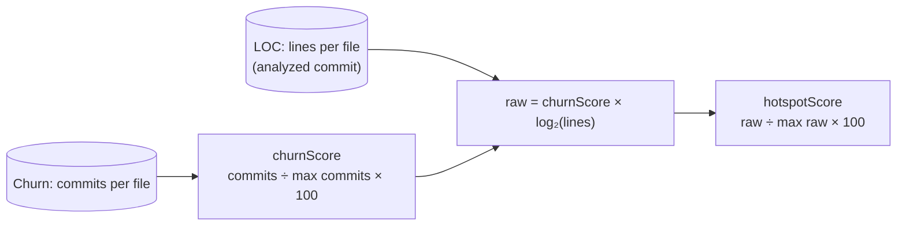

# Hotspots

A **hotspot** is a file that is both **busy** and **big**: it changes often, and every change lands in a lot of code. Either alone is ordinary. A large file nobody touches costs nothing day to day; a tiny file edited every week is cheap to edit. The combination is where reviews drag, regressions hide and knowledge gets expensive, which makes hotspots the usual first place to spend refactoring time.

The idea comes from Adam Tornhill's *Your Code as a Crime Scene*: change frequency is a measure of where people work, and size is a cheap stand-in for complexity. GitRelic scores every tracked file that changed in the window.

## Quick read

- **The field** (Atlas) — every file placed by commits (across) and lines (up), both on log scales. The coloured curves are equal-score lines at 25, 50 and 75, so anything past the 75 curve is critical. The hottest files are named in a column beside the plot.
- **By package** (Atlas, corner toggle) — each package is a circle, each dot one of its files, hottest at the centre. It answers *where* heat concentrates.
- **The inspector** — with nothing selected, the headline counts, the findings, how files spread across the tiers, and the top five. Click any dot for that file's full profile.

## How the score is computed

1. **Churn.** Each file's commit count in the window, as a score out of 100 relative to the most-changed file ([Churn](/analyzers/churn)).
2. **Size.** Lines in the analyzed commit, the same count the LOC analyzer reports.
3. **Combine.** `raw = churnScore × log₂(max(1, lines))`. The logarithm keeps size from swamping churn: a 10,000-line file counts about twice a 100-line one, not a hundred times.
4. **Normalise.** The top file scores 100 and everything else is relative to it.

Only files present in both reports are scored: files deleted before the analyzed commit have no size, and files that never changed have no churn.

### The tiers

| Tier | Score | Meaning |
|---|---|---|
| **Critical** | ≥ 75 | Among the hottest in the repo. Start here. |
| **Warning** | 50–74 | Hot. Worth watching, and worth a look when you're nearby. |
| **Moderate** | 25–49 | Warm. Mostly churn on a modest file, or size with modest churn. |
| **Low** | < 25 | Most files. Drawn as density in the field, not as dots. |

Because the score is relative, the top file is always 100 and the critical tier always has at least one member. Use the tiers to rank within a repo, not to compare repos.

## Reading the field

The field puts the two inputs on the axes instead of hiding them inside one number, so you can see *why* a file scores what it does:

- **Up and to the right** is hot on both counts: large files that keep changing.
- **Far right, low down** is hot on churn alone: small files edited constantly. Often configuration, feature flags or generated files.
- **High up, left** is large but quiet. Not a hotspot today, whatever its size.

Because `score ≈ commits × log₂(lines) ÷ k`, a file scoring S sits on the curve `commits = S × k ÷ log₂(lines)`. Those are the coloured curves. They bend because a bigger file needs fewer commits to reach the same score.

On React (12 months to `eb8feb7109`), the field separates two kinds of heat. `ReactFizzServer.js` (33 commits, 6,656 lines), `renderer.js` and `ReactFiberConfigDOM.js` are large engine files that keep changing. `ReactFeatureFlags.js` scores 56 on 282 lines, because it changed in 29 commits along with its six forks.

## By package

Each top-level package (a `packages/<name>` folder in a monorepo, otherwise the top-level directory) is a circle sized by its file count. Its files are dots in a sunflower, hottest at the centre.

The point is concentration. On React, `packages/shared` has 7 of its 22 files at 25 or more, while `compiler/` has 7 of 1,369. The same count of warm files means opposite things.

## Findings

The inspector states up to three findings, each naming files or packages you can click:

- **The hottest file**, with its commits and lines.
- **Two kinds of heat**, when the files scoring 25+ include both large files (1,000+ lines) and small ones (under 300).
- **Concentration**: the package with the largest share of its own files at 25+ (at least three, and at least 20%), set against the biggest package when that one runs much cooler.

## What it suggests

- **Critical and large:** split the file along the seams its history shows. The files it changes with ([Coupling](/analyzers/coupling)) are a good map of those seams.
- **Hot on churn alone:** ask why it changes so often. Feature flags and generated config are fine; hand-edited forks that move in lockstep are one change made several times.
- **A package where heat concentrates:** that's where review attention and tests pay off most.

## Related analyzers

- **[Churn](/analyzers/churn)** — the commit counts behind the score, by file and by directory.
- **[Cursed Files](/analyzers/cursed-files)** — risk from several signals at once (churn, ownership, many authors, fix commits, parallel edits). It doesn't count size, so a top hotspot can sit just under the cursed line.
- **[Coupling](/analyzers/coupling)** — what a hotspot changes together with.

## Limitations

- **Lines are a rough proxy for complexity.** A long table of constants scores as large as a long state machine.
- **Commits, not volume.** A one-line fix and a 1,000-line rewrite each count once. See [Rewrite Ratio](/analyzers/rewrite-ratio) for volume.
- **Relative scores.** The top file is always 100; a quiet repo still has a "critical" file.
- **Renames reset churn.** Commits under an old path don't count toward the new one. See [Renames](/analyzers/renames).
- **Test files are scored too.** A large test file that changes with its source shows up (on React, `ReactDOMFizzServer-test.js` scores 71).
